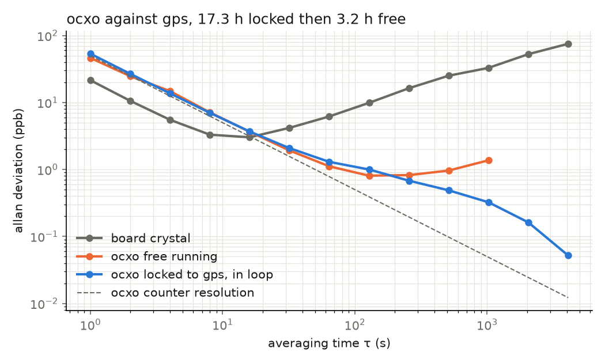

# gpsdo

A GPS-disciplined clock for the Tang Nano 9K. Every second the FPGA counts
27 MHz cycles between GPS 1PPS edges, and a carry-chain TDC measures where
inside the cycle each edge landed, about 25 ps a tap. A 10 MHz OCXO is
counted over the same GPS second, and a PI loop steers it onto GPS through
its tuning pin. Measured figures are in [docs](../docs/README.md).

## Build and Run

    make            # bitstream
    make sim        # cocotb, one run per module
    make lint       # verilator
    make formal     # uart_tx proof
    make flash
    picocom -b 115200 /dev/ttyUSB1   # the second usb serial port

Drain the port before trusting a capture: the tty buffer hands back bytes
from whatever was flashed before.

## Wiring

| Signal | Pin |
|---|---|
| GPS 1PPS, 3.3 V | 25, pulled down so an unplugged module reads 0 |
| OCXO out (pin 1) | 1 kΩ at the pin, wire to 26, 2 kΩ from 26 to GND: its output is 5 V logic |
| OCXO Vref (pin 3) | 10 kΩ from 27, 10 to 22 µF from pin 3 to GND |
| OCXO Vcc (pin 5) | 5 V, its own supply: 600 mA warming, 250 mA warm |
| OCXO GND (pin 2), GPS GND | board GND, shared with the OCXO supply |

The OCXO is a CTI OSC5A2B02. Pin 3 is its tuning input, 0 to 4 V with a
positive slope of 0.76 ppm/V, measured by stepping it; the RC filter turns
the sigma-delta stream into a steady voltage. Pin 4 is unconnected.

The OCXO's 5 V edges jam the GPS. With a small patch antenna next to it the
receiver heard a few satellites at 20 to 25 dB and lost its fix; with the
OCXO off the same antenna got 30 to 36 dB and a fix in seconds, and pulling
only the pin 1 wire recovered about half of that. A larger antenna a metre
away gave PPS in all but 12 seconds of three hours. Keep the antenna away
from the OCXO and its wires, and the 1 kΩ right at pin 1.

A u-blox NEO-M8N only starts its timepulse once it has a fix. On modules
without a PPS header pin, solder to the PPS LED pad.

LEDs: 0 toggles on every PPS, 1 calibration mode, 2 locked, 3 holdover,
5 heartbeat.

## Output

One line per second:

    019BFCC0 1F3 00989680 8000

The first field is the board clock's period in cycles. 0x019BFCC0 is
27,000,000, dead on frequency, and each count off is 37 ppb. The second is
the TDC code, how far the edge ran along the chain before the next clock
edge. In simulation the chain has no delays and reads full scale, so codes
only mean anything on silicon. The third is the OCXO's cycles over the same
second, 0x00989680 when it is on frequency, 100 ppb a count. The last is
the tuning word, 0x8000 at mid scale. In calibration mode the line stops
after the second field, to keep the sample rate up.

    cat /dev/ttyUSB1 | python3 host/ocxo.py

prints the OCXO's error each second, its mean over the last minute and the
tuning voltage.

    python3 host/gpsdo_log.py /dev/ttyUSB1 --out overnight.log
    python3 host/gpsdo_plot.py overnight.log --png overnight.png

logs overnight with UTC timestamps, survives USB disconnects and prints a
status each minute; gpsdo_plot.py plots lock-in, Allan deviation with the
100 ns counter resolution limit line, and time error.

## Modules

| Module | Role |
|---|---|
| pps_capture | clock cycles between PPS edges |
| tdc, tdc_chain, tdc_core | the 1200-tap carry-chain TDC |
| ring_osc, btn_toggle | on-chip ring oscillator, S1 switches the TDC onto it |
| disc_loop, sd_dac, tmr_reg | PI loop, sigma-delta DAC, triplicated registers |
| uart_tx | 115200 baud telemetry |
| tic | two-channel time interval counter |
| tdc_wu | wave union, several chains summed |
| cal_mon | background calibration off the ring |
| rf_stamp | UTC timestamps for radio events |

The last four are simulated and linted on their own. tic runs in
[ticprec](../extras/ticprec/README.md) and rf_stamp in
[radio433](../extras/radio433/README.md).

## The TDC

The chain is built from segments joined by LUT hops, because the placer
cannot legalise one continuous 1200-ALU chain. Each hop shows up as one
wide tap, 4 to 6 ns where the carry crosses a fabric column, which is the
code-density non-linearity every carry-chain TDC has. Bubbles in the
thermometer code are handled by counting ones rather than priority
encoding.

Segments started at 100 taps: 451 codes a period, with the hops eating 47%
of it. 200 gives a third more range and drops that to 36%. 300 does not
place, since a segment has to fit a fabric column. N=1200 is still about
twice the codes needed to span a period.

The trigger used to be a reduction OR over every tap, which put an
enormous combinational path in the control logic. Whether it worked
depended on placement: in one bitstream N=128 to 320 ran at full rate
while 64 and 400 sat dead, and every size passed simulation. Detecting the
edge on the trigger net fixed all of them.

## Calibration

S1 switches the TDC trigger from the GPS to the on-chip ring oscillator.
Nothing locks the ring to the crystal, so its edges land evenly across the
clock period, which is what code-density calibration needs, with no GPS
attached. The 15-stage ring runs at 27 to 30 MHz, divided down to a few
kHz.

    timeout 60 cat /dev/ttyUSB1 > taps.txt
    python3 host/tdc_cal.py taps.txt --csv cal.csv

This prints the resolution, DNL, INL and quantisation, and writes a per-tap
table. Its center_ps column is the calibration LUT: raw code in,
picoseconds out.

Carry delays stretch as the die warms, so a one-off LUT goes stale. cal_mon
keeps a second TDC on the ring and decimates its codes to a trickle that
can stream next to the PPS lines; `tdc_cal.py --window` then shows the
drift block to block. Verified in simulation, not yet on the bench.

## Discipline Loop

The error is the OCXO's count short of 10,000,000 each second, positive
when it runs slow. The OCXO is sampled on the board clock rather than used
as a clock: through the divider its edges are too slow to clock flops, and
on silicon that double counted by up to 12%. Those errors summed
are its phase against GPS in cycles, so the integrator holds phase and the
loop pulls the frequency error to zero, with a fixed phase offset.

One tuning step moves the OCXO only ~4e-4 Hz, so the error is scaled up by
2^8 before the loop, and with KI=3 each cycle of phase moves the word 32
steps. That gives a time constant of about 80 s, set by the OCXO's tuning
slope. The proportional term is kept tiny (KP=16): the count is only good
to one cycle a second, and feeding that straight to the tuning pin would
add 100 ppb of jitter. The word drives a first-order sigma-delta on the
tuning pin, and the RC filter turns it into a steady voltage.

The loop only acts on counts within 50 cycles (5 ppm) of nominal, so a
missing or still-warming OCXO, or a count spanning a PPS gap, never reaches
the integrator. Ring calibration is masked out too. If PPS is lost for
over a second the loop enters holdover and freezes the word, so the OCXO
free-runs on its oven. LED 2 lights once the count has stayed within one
cycle for 32 seconds.

The top-level test checks the sign: a slow OCXO raises the word, a fast
one lowers it, and one out of the window leaves it alone. OPEN=1 holds the
word at FIXED instead, for free running runs.

## Measured

The loop closed for 17.8 hours, with PPS in 99.8% of seconds, logged with
host/gpsdo_log.py, and on an earlier night held open at the locked word for
3.2 hours. The OCXO pulls in from -250 ppb within three minutes, and over
the long run the tuning voltage moved between 1.97 and 2.03 V as the loop
followed its drift. The mean error after pull-in was -0.015 ppb.

| τ | board crystal | OCXO free | OCXO locked |
|---|---|---|---|
| 1 s | 21 ppb | 46 ppb | 54 ppb |
| 16 s | 3.0 ppb | 3.7 ppb | 3.7 ppb |
| 256 s | 16 ppb | 0.82 ppb | 0.68 ppb |
| 1024 s | 33 ppb | 1.4 ppb | 0.32 ppb |
| 4096 s | 75 ppb | | 0.052 ppb |

Below about 100 s both OCXO curves sit on the counter's limit, one cycle of
phase in a second, so the OCXO's own short-term stability is hidden there.
Above it the free OCXO wanders and the locked one keeps falling. The
locked figures are in loop, against the same GPS that steers it, and a
point is only plotted with at least 8 blocks of its τ behind it.

    python3 host/ocxo_adev.py locked.log free.log --png ocxo-adev.png

## Single Event Upsets

A flipped bit in the loop state is a real failure mode for a clock that
flies. test_disc_loop_seu locks the loop, flips one random bit of the
48-bit integrator or the 16-bit DAC word at a random clock, runs 30 more
PPS and sorts the outcome. Same 200 upsets, same seed, both builds:

| Build | Masked | Transient | Out of lock after 30 s |
|---|---|---|---|
| plain | 61 | 9 | 130 |
| TMR=1 | 200 | 0 | 0 |

In the plain loop most of the integrator sits above the KI shift, so a
flip lands straight on the control word and the integrator then winds it
back out one PPS at a time. A DAC flip only lasts until the next PPS.

TMR=1 keeps three copies of both registers, reads them through a majority
vote and rewrites all three from the vote every clock, so a flipped copy is
outvoted before the loop reads it and repaired a clock later.

Synthesis nearly hid all of it. The three copies have identical inputs, so
yosys merged them back into one register and the vote did nothing, with
the simulation still passing. tmr_reg builds each copy from kept DFF
primitives, and the synthesised gpsdo_top has all 3 × 48 + 3 × 16 of them.
The cost for the loop is 69 → 197 flip-flops and 90 → 233 LUTs, so it is
off by default.

## Instruments on the Same Core

- **Time interval counter (tic).** A free-running counter gives the coarse
  time from an event on channel A to one on B, and a TDC on each channel
  gives the sub-cycle position, so the interval is good to tens of ps once
  the LUT is applied. Point A at the PPS to time any signal against UTC.
  Two full chains fit: 43% LUT, 38% ALU, 126 MHz.
- **Wave union (tdc_wu).** Several chains off the same edge, codes summed.
  The hops land at different taps in each chain, so the sum smooths the DNL
  spikes. Two chains of 1200 fit (57% LUT), four do not.
- **RF timestamper (rf_stamp).** The PPS resets a within-second counter, so
  every event comes out as {second, cycle, fine}. Edges closer than the
  ~44 µs shift-out are dropped, fine for OOK symbols of hundreds of µs.

## Sawtooth Correction

The NEO-M8N snaps its PPS to an internal clock, so each pulse sits a few
ns off true UTC, and its UBX-TIM-TP message reports that offset as qErr in
picoseconds. host/ubx.py parses it, and subtracting qErr from the TDC phase
of the same pulse should remove most of the 6.5 ns PPS jitter. The parser
is tested against synthetic frames; routing the M8N UART to the FPGA is
the hardware side.

## Next

- Time the OCXO against GPS with the TDC instead of counting cycles, to see
  below 100 s.
- Drop N to about 700, since half the chain is spare range.
- Stream cal_mon on the UART, tagged, for live recalibration.
- The rest is in the [roadmap](../docs/README.md#roadmap).
